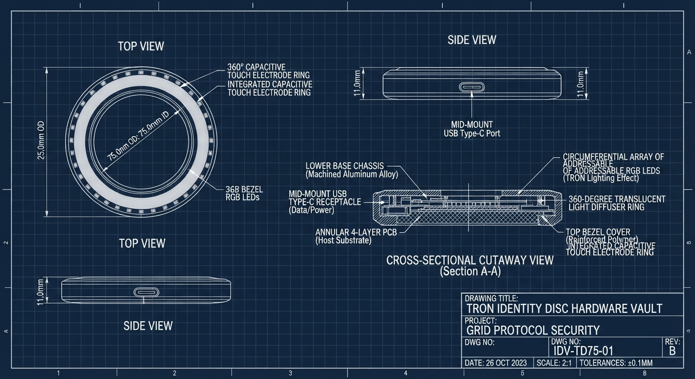

# identity-disc-hardware

<p align="center">
  
</p>

The hardware side of [Identity Disc Vault](https://github.com/bilism1010/identity-disc-vault):
the physical disc you tap to prove presence before `idvault` releases a secret. The
vault repo holds the Rust CLI. This repo holds the disc's design files and the firmware
that runs on real boards.

**Status:** disc firmware milestone M1 (serial) works on the bench board: 16/16 hardware
checks pass. BLE (M2) and on-disc settings (M3) are not started. See
[docs/FIRMWARE_SPEC.md](docs/FIRMWARE_SPEC.md).

## What is here

| Path | Contents |
|---|---|
| [CAPABILITIES.md](CAPABILITIES.md) | Surveyed capability sheet for the prototype board. The source of truth for its hardware facts. |
| [firmware/identity-disc/](firmware/identity-disc/) | The disc firmware (Arduino core 3.0.7, LovyanGFX): JSON-lines protocol over serial, HMAC PRF with a key in NVS, press-and-hold approval, glowing status ring |
| [docs/FIRMWARE_SPEC.md](docs/FIRMWARE_SPEC.md) | Firmware spec and protocol v1 |
| [docs/PURPOSE.md](docs/PURPOSE.md) | Why this exists, what the prototype does and does not prove, milestones |
| [docs/ARCHITECTURE.md](docs/ARCHITECTURE.md) | Modules, request flow, crypto, device identification, status ring |
| [docs/USER_GUIDE.md](docs/USER_GUIDE.md) | Using the disc: requests, approve and deny, ring meanings, errors |
| [docs/DEVELOPER.md](docs/DEVELOPER.md) | Setup, build, flash, test, conventions, bench safety rules |
| [docs/BOM_PROTOTYPE.md](docs/BOM_PROTOTYPE.md) | Prototype bill of materials, board hardware, pin map |
| [tools/](tools/) | `flash.sh` (compile and flash only the disc), `find-disc.py` (finds the disc's port by MAC and USB ID), `disc_test.py` (`info`, `prf`, `demo`, `check`) |
| [examples/c3-round-test/](examples/c3-round-test/) | Display and touch check sketch for the prototype board |
| [hardware/bom/](hardware/bom/BILL_OF_MATERIALS.md) | Rev 1.0 target design: bill of materials, stack-up, print guide, firmware outline |
| [hardware/cad/](hardware/cad/) | STL and OBJ models of the disc shell, plus the script that generates them |
| [reference/input-knob/](reference/input-knob/) | Touch, display and BLE code from the sister `input-knob` firmware, kept as a starting point |
| `backup/` | Factory firmware image of the prototype board (gitignored, local only) |

`hardware/` and `assets/` were copied from the vault repo at commit `9be0cea`. The vault
repo still has its own copies.

## Disc firmware

```
sh tools/flash.sh                      # compiles and flashes only the MAC-matched disc port
python3 tools/disc_test.py info        # refuses any port that doesn't report device "identity-disc"
python3 tools/disc_test.py demo        # shows the ring: cyan standby, amber presence/warning, red alert, green ok
python3 tools/disc_test.py check       # 8 automatic checks, then guided touch checks; run it yourself so you see the prompts
```

The ring is drawn on the screen rim because this board has no LEDs. Its speeds follow the
vault's light-ring design: standby slow, presence brisk, warning faster, alert rapid.
Other boards on the same Mac (the Pro Micro knob, the Elecrow display) are never opened.

## Two hardware targets

**Rev 1.0 target design** (in `hardware/`): a 75 mm annular disc built around an
ESP32-S3, an ATECC608B secure element, a 16-LED light ring and a capacitive touch ring.
It is a USB FIDO2 key. This is a design on paper; no PCB exists.

**Prototype board** (on the bench): an AliExpress ESP32-C3 1.28" round touch display
with a 240x240 GC9A01 IPS panel and a CST816 touch controller. It appears to be an
ESP32-2424S012 or a clone of it. It is the first thing the disc firmware will run on.

The prototype board is a much smaller device than the target design. It can:

- Show a round "disc" UI and take a tap as proof of presence
- Hold a device key and answer challenges over USB serial or BLE
- Use the HMAC or Digital Signature peripheral so the key is not readable by firmware

It cannot:

- Act as a USB FIDO2/U2F security key. The C3's USB is a fixed serial + JTAG bridge.
- Offer secure-element grade key protection or native ECC key storage
- Do WebAuthn PRF as a platform or USB authenticator. The host CLI would need a custom
  serial or BLE transport instead.

It also has no LED ring, so the light-ring states in the target design would have to be
drawn on the screen. See "Fit for Identity Disc Vault" in
[CAPABILITIES.md](CAPABILITIES.md).

Two things in the capability sheet are still open: nobody has yet confirmed the display
output by eye, and touch coordinates have not been checked against the screen.

## Build and flash the test sketch

`examples/c3-round-test/` shows colour bars, then a "Board OK" screen with a counter
that ticks once a second. Touching the screen draws a dot and logs the coordinates over
serial.

Requirements:

- Arduino core `esp32:esp32` 3.0.7
- LovyanGFX 1.2.26
- `arduino-cli` (the copy bundled with Arduino IDE 2 works)

The board settings (`esp32:esp32:esp32c3:CDCOnBoot=cdc,FlashSize=4M`) come from the
sketch's `sketch.yaml`.

```sh
arduino-cli compile examples/c3-round-test
arduino-cli upload --port <port> examples/c3-round-test
```

Notes, all from CAPABILITIES.md:

- `CDCOnBoot=cdc` is required, or `Serial` output does not appear on the USB port.
- Flashing needs no button presses. esptool enters and leaves the bootloader itself.
- Opening the serial port resets the board.
- If other ESP32 boards are plugged in, always pass `--port` and check the MAC before
  writing. The bench unit is `48:31:b7:3d:40:10`:

  ```sh
  ~/Library/Arduino15/packages/esp32/tools/esptool_py/4.6/esptool \
    --chip esp32c3 --port <port> read_mac
  ```

- Use the esptool that ships with the Arduino core (path above). The Homebrew/pip
  `esptool` on the development Mac is broken.

### Restore the factory firmware

The original 4 MB flash image was read out before anything was flashed. It lives in
`backup/c3-original-flash-4MB.bin`, which is gitignored, so it exists only on the
machine that made it. To restore:

```sh
esptool --chip esp32c3 --port <port> write_flash 0x0 backup/c3-original-flash-4MB.bin
```

## Related repos

- [identity-disc-vault](https://github.com/bilism1010/identity-disc-vault): the `idvault` CLI this hardware serves
- [input-knob](https://github.com/bsommers/input-knob): ESP32-S3 rotary knob firmware that the reference code comes from

## License

Licensed under the [Apache License, Version 2.0](LICENSE). Copyright 2026 Bill Sommers.
